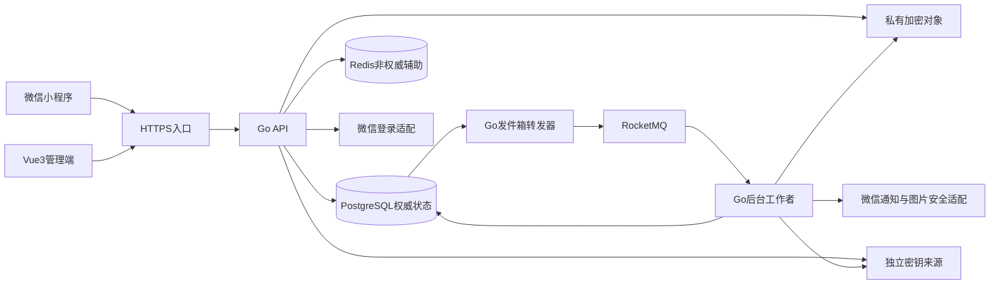

# 详细架构设计

版本v0.2，2026-10-16。输入：G1批准的需求基线v0.2及 `../approvals/G2.md` 批准的方案B。本文是待G3评审的设计，不是实施或上线批准；设计选择与待验证项不写成已验证事实。

## 1. 架构与部署（REQ-001、019、020）

采用Go模块化单体，同一代码基线按角色部署API与后台工作者；PostgreSQL为业务权威，Redis为可丢弃的限流/加速层，RocketMQ为异步投递通道。两端分别使用uni-app和Vue3模板；七牛私有对象存储保存加密学生卡与隔离备份。密钥服务与数据库/对象备份独立。

API、发件箱转发、后台消费者/定时补偿为三个运行职责，可共享后两者进程但分别限并发、连接池和健康状态。静态管理端和数据库/中间件不开放未认证的公网管理入口。暂不指定机器数量、CPU/内存、云区域或高可用副本数；这些不在G2选择中自动确定。

## 2. 模块与依赖（REQ-001–008、014–020）

| 模块 | 写入边界 | 对外能力 |
| --- | --- | --- |
| identity | 用户、认证、会话、后台角色 | 身份解析、认证资格、场景授权 |
| wish | 心愿版本、状态、申请、匹配 | 发布/回退/唯一应愿/额度/期限 |
| conversation | 原匹配会话、消息 | 发送待审、允许送达、增量读取 |
| moderation | 词库版本、内容复核、举报、处罚、申诉 | 机器判定、人工决定、限制状态 |
| crisis | 危机事件、关怀及处置时间线 | 隔离、危机案件授权、误报解除 |
| profile | 本人记录、标签隐藏、黑名单 | 用户控制与公开资料投影 |
| privacy | 注销工作、对象清理、证据删除 | 基线10.4矩阵与恢复删除 |
| notification | 站内通知、外发尝试、发件箱 | 微信失败兜底、持久待办 |

模块只能经应用服务提交跨模块命令；事务由命令入口统一控制，不能模块内部独立提交再让MQ补核心状态。repository显式接收事务上下文，接口/消费者复用同一规则。禁止用前端可见状态或Redis权限快照执行匹配等命令。

## 3. 权威状态及并发协议（REQ-004–007、014–018）

核心写命令统一使用PostgreSQL短事务。设计锁顺序：参与账号的guard行按UUID排序→相关心愿按UUID排序→申请/匹配/会话→审核任务/消息→发件箱。涉及后台角色的操作先校验独立管理员会话，业务锁序不反转。参与账号包括操作者、内容作者、当前应愿人/申请人及必要通知接收人。

先只读发现参与者集合，开启事务按排序锁账号guard，再重读对象和关系；集合改变则回滚、重算并重试，不在已持锁后倒序追加guard。所有创建关系、拉黑、处罚、最终审核、注销生效均遵守此协议，所以“拉黑/注销已提交后又同意旧申请”不能成立。死锁/版本冲突有限重试同一幂等命令，最终返回可重试冲突，不吞掉失败。

账号guard包含生命周期、认证状态、权限代次；不是永久审计，注销清理完成后删除。已注销账号不存在时只终止旧任务，禁止消费者根据事件重新创建账号。额度以被锁许愿人的当前已上架+应愿中记录计数，使用数据库当前时间剔除应已过期的上架记录并在同事务落实过期，再判断≤3；每次会增加活跃数的普通回退/上架都走相同入口。部分唯一约束兜底唯一当前应愿人和有效申请；跨行3条限制不能仅靠单行CHECK。

并发先后以命令事务提交为生效点。列表/详情用权威数据库单条查询或一致读取事务确定可见性，授权语句快照早于注销提交的在途响应不能撤回；注销提交后开始的新授权不可读。敏感字段响应禁止服务端共享缓存和客户端持久化，不把此边界解释为可访问旧公开快照。

## 4. 核心流程（REQ-002–008、014–018）

| 流程 | 同步原子步骤 | 后续异步工作 |
| --- | --- | --- |
| 发布/修改 | 校验认证/字段，生成新内容版本，撤下原公开版本，旧申请和旧审核失效，写扫描任务及发件箱 | 工作库读当前版本扫描；普通命中人工待审，危机隔离，合规内容尝试公开前再次复核 |
| 通过申请 | 锁双方及心愿，检查上架有效/认证/处罚/拉黑/待审/唯一性，确定唯一匹配，心愿应愿中，建立新会话，其他申请失效，写站内通知和发件箱 | 尝试微信通知，不影响已提交匹配 |
| 发送消息 | 校验当前原匹配应愿中可写，保存加密待审正文和扫描任务；不立即交付对方 | 普通通过后同锁序复核才送达，危险不送达，状态变化取消且不重放 |
| 确认实现/还愿 | 仅许愿人；实现关闭写入并取消待审消息；提交故事时原子进入已还愿并写故事待审版本 | 故事审核单独控制公开，驳回/撤回不回退已还愿 |
| 普通回退 | 已实现回应愿中须按B01查额度，保留原匹配；应愿中回上架解绑旧人，旧会话只读，旧申请失效，按刷新/原期限判断 | 如涉及期限修改则重审；无业务改动且获准的普通回退按基线期限与权限执行 |
| 例外退出 | 合法未受罚方/拉黑方可从应愿中/已实现退出，统一已撤下，不占额度，期限不刷新、无当前人；已还愿拒绝主动退出 | 后续许愿人主动重审上架；不自动公开或复活关系 |
| 拉黑/禁言封禁 | 拉黑取消双向未匹配申请与待审消息；禁言/封禁设置限制、暂停尚存应愿、下线受罚者上架心愿，取消待审交互 | 限制到期可更新权限，但不重放交互、不自动上架/重配 |
| 轻微警告 | 同事务移除违规内容公开/送达资格，创建一次warning及站内提示；未设置mute/ban，不暂停无关应愿 | 本人展示后启动一次30秒确认计时，重进不重置，见第10节 |
| 危机 | 内容未公开/不送达，写隔离状态、案件、证据范围及站内关怀/后台待办 | 外发通知失败可重试，误报解除仍走普通审核；夜间自动工作不停止 |
| 注销 | 标记deleting，撤销会话，取消相关任务、申请/送达；按六行矩阵改存活方状态，并对相关存活方故事设置持久privacy_hold屏障，所有普通读取立即拒绝；创建清理与外部删除工作 | 清除普通行/对象/非涉案审计、处理自有故事身份引用；完成后purged，不得提前宣称全部删除 |

## 5. 发件箱、消费及取消（REQ-006、007、015–018）

事件仅含event_id、event_type、aggregate_id、aggregate_version、correlation_id和技术时间，不含学号、OpenID、内容正文、卡片原图/签名URL。topic按工作类型分组，不按用户身份生成。数据库工作项保留待执行状态，Broker事件只是唤醒信号；可按未完成工作补发，MQ丢失/重复不改变权威结果。

发件箱短事务领取租约→提交→发送MQ→记录确认；发送成功但确认落库前崩溃可能重复，消费者按operation_id在PostgreSQL去重，并锁当前对象复核。消费者不得信任事件自带角色或旧审核结果。工作成功与业务状态变化、收件箱去重同事务提交；对象已删除/取消则记录无操作成功并终止，去重结果不永久保留个人关联。

外部API调用不持业务长事务：领取工作、准备最小通用内容、提交后调用，再写尝试结果。已发外部通知不能撤回，通知仅提示“有新进展，进入小程序查看”，点开后重新授权；注销提交后不启动新的用户通知，已进行的外部请求不能由设计虚称可撤销。外部重试可能重复提示，不能保证外部恰好一次。

失败分为临时依赖故障、业务已取消、不可恢复配置故障；仅临时故障重试，取消不重放，配置故障保留可见待办且告警。重试退避/最大次数/死信保留为配置设计参数，在环境核验后锁定，不当作新人工响应承诺；死信只含技术ID，管理员重新驱动前重新业务复核。

## 6. Redis及聊天（REQ-006、007、014–016、018、021）

Redis首发用于请求频率控制、可丢弃计数与词库版本提示，不存身份权限权威、聊天正文、学生卡和完整公开内容。命令关键额度与幂等放PostgreSQL；Redis不可用不降级为放开权限，读接口可回权威DB，敏感写接口在网关限流无法提供保护时限流拒绝并告警。阈值配置经容量验证，不擅设每人业务发布上限。

聊天采用HTTPS增量拉取已送达消息，游标按送达事务分配的delivery_seq单调推进，待审message_id不占读取序号；页面可见每3秒拉取，隐藏/离开时暂停。3秒为本次用户授权采纳的初始技术数值，不是对所有网络的送达SLA；负载方案见performance.md。未读通知独立于聊天拉取；本轮不引入WebSocket。

## 7. 部署、运行及故障（REQ-015、017、018、020、021）

| 故障 | 设计行为 |
| --- | --- |
| PostgreSQL不可用 | 停止认证、写命令和敏感读取；不从Redis授权或向MQ承诺业务已成功 |
| MQ不可用 | API可提交业务与持久待办，扫描对象保持不公开/不送达，发件箱积压告警；恢复补发 |
| Redis不可用 | 权威DB仍判业务，非关键读可继续；受保护写流量按上述限流策略拒绝，不读旧权限 |
| 图片/文本判定依赖失败 | 扫描待处理，不公开/不送达；人工认证不被图片失败自动通过 |
| 对象存储/密钥不可用 | 敏感资源读取失败；无可用加密能力不接收明文资料；清理未完成保持不可访问 |
| API/工作者重启 | 数据库工作与发件箱恢复，租约超时重领，重复操作幂等；自动措施不依赖人工上班 |

健康检查分存活与就绪：API必需DB、密钥/认证配置就绪；工作者另检查MQ链路和扫描依赖状态，不能仅Producer初始化成功视为Broker可写。以积压年龄、扫描失败、取消后重试、DB锁等待、越权拒绝、清理失败为运行指标；不记录敏感正文。备份与恢复闸口见security.md。

## 8. 性能与验证边界（REQ-020、021）

列表走PostgreSQL索引、游标分页与字段投影，不依赖Redis全文缓存。按普通列表服务端收请求至完整响应的计时采样，P95≤100ms；不含客户端网络/渲染，提交类不套用。API与工作者分别限连接和并发，防止后台扫描/清理抢占所有数据库资源。

本次已按用户“采纳推荐数值方案”的授权落实performance.md v0.1：8000用户、2000日活画像、300在线，常规混合87请求/秒；120聊天用户每3秒拉取、90公开浏览用户每5秒、60本人记录用户每10秒、30写用户每10秒，全体每15秒查通知；预热10分钟、正式30分钟、3次独立重复，另有冷启动与2倍频率压力组。performance.md v0.2按复审将accepted=100000与匹配/会话一一关联，足量历史页及本人活跃稀疏/空页分别安排与统计，不要求活跃列表凑满20条。数值已获本次授权采纳，硬件/软件指纹须真实执行前填齐并核对；未执行前不宣称通过。验证覆盖options.md V01–V07及基线10节取消/注销/拉黑并发，未运行任何产品测试。

## 9. 追踪与下一闸口

REQ-001–008由模块/核心事务/API覆盖；REQ-009–013保持延期无表/接口；REQ-014–019由权限、审核、危机、隐私设计覆盖；REQ-020由G2方案及decisions.md追踪；REQ-021由本节及后续负载确认覆盖。详细数据见database.md、端点见api.md、保密和恢复见security.md，重大取舍见decisions.md。

当前G2已批准；G3未批准。设计待独立架构评审，版本/负载/外部能力与运行核验均不以文档存在替代实际验证，不进入业务代码阶段。

## 10. 架构评审修订协议（AR-001–AR-004）

来源：用户原始指令“reviews/architecture-review.md 评审报告中的问题均按建议处理，并采纳推荐数值方案”。以下为该授权内已采纳设计细化，不修改G1业务规则，也不签发G3。数值方案见performance.md；逐项处理与关闭条件见 `../reviews/architecture-remediation.md`。

### AR-001 送达序号（REQ-007、015）

消息提交只生成message_id和client_message_id，delivery_seq=NULL。最终审核通过且当前业务可送达时，按既有账号/心愿锁序后锁会话行，取next_delivery_seq（初始1），将其赋给消息并递增计数，与消息delivered和幂等回执同事务提交；业务已失效则cancelled且不分配序号。无人工审核的快路径也走同一个送达事务，不提前分配。

会话锁保持到事务结束，B先送达获1、A后审获2；回滚同时回滚计数与赋值，重试检查原消息已送达则返回既有序号。读取只查delivered且delivery_seq>after_seq，升序limit，返回最后一条实际交付的序号；空页保持旧after_seq。不用MAX(next_seq)、提交时间或message_id推进。分页不跳未读取行，并发后续送达序号更大，下一页仍可获得。序号是交付顺序，UI可显示submitted_at但不能用提交时间做补拉游标。

### AR-002 轻微警告（REQ-016、019）

复用penalties的action_kind=warning/mute/ban及通知：轻微→移除违规内容+一次warning；一般→移除+mute七天；严重→移除+ban永久+限定证据；危机→隔离+危机流程，不自动禁言。warning不设置账号禁言、不暂停原匹配/无关写入，只要求警告弹窗30秒后才能确认关闭；技术端不得把无法强制用户停留前台解释为可提前确认。

本人首次进入警告展示调用display，服务器写一次first_displayed_at，confirmable_at=first_displayed_at+30秒；更早的通知创建时间不是计时起点。客户端先显示弹窗再发display，网络失败持续不可确认，服务端确认前须有display记录；不宣称能证明用户实际阅读。重进页面沿用原起点，后台时间按服务端流逝，不额外添加累计前台停留规则；满30秒后ack只更新一次。多次提交同一违规处理的同键命令仅生成一次warning；不同违规事项可各有警告。

### AR-003 注销的公开屏障（REQ-008、018）

注销生效事务在锁注销主体、关联许愿人及心愿后，**先**将所有关联的存活方故事设置privacy_hold、hold_epoch递增、旧待审公开结果失效，再清除当前匹配和普通身份关联。无法准确判断正文是否含身份时，保守隐藏该匹配对应故事全部版本；相关自有心愿的可公开版本也设同类屏障。该操作与deleting标记同事务提交，不等待清理消费者。

屏障绑定幸存内容的稳定ID和代次，不依赖后续将被删除的helper_id或matches行；注销者普通关联清除后仍存在，读列表、详情、主页、分享统一检查无有效屏障。只给作者返回需要重新审核的状态，不返回注销者身份或旧公开正文。清理者可受控读取待脱敏源，公众/原应愿人不能通过旧链接读取。

清理工作剔除身份引用后生成新内容版本并提交普通审核；每个屏障记录required_content_version。仅满足所有适用屏障要求、对应新版本审核通过且当前无其他限制时，原子解除可释放屏障并公开。旧审核、取消/重试或服务重启不解除；又发生其他注销时新代次再次失效旧批准。deleting账号自身资料仍按原规则全部不可读。

### AR-004 版本化审核输出（REQ-008、015、019）

每个内容版本记录school_related、school_detection_version、school_detection_state及审核结果。涉校检测未完成不得公开；school_related=true强制人工通过，即使其他词库合规。公开投影统一包含content_version、school_related、notice_codes、notice_text，涉校值为UNVERIFIED_SCHOOL/“未经证实”；列表、详情、主页卡片、分享打开页一致，分享不生成旧标记正文快照。

修改生成新版本，重跑涉校判定，不从旧approved或标记推导新版本；当前新版本未通过期间不展示旧公开正文。人工驳回分别保存reason和revision_suggestion两个非空字段，作者状态/后台案件均能读取；不能只保存原因而丢修改建议。建议字段不能暴露他人隐私，可使用“删除可定位信息后重提”等规范化文字。
