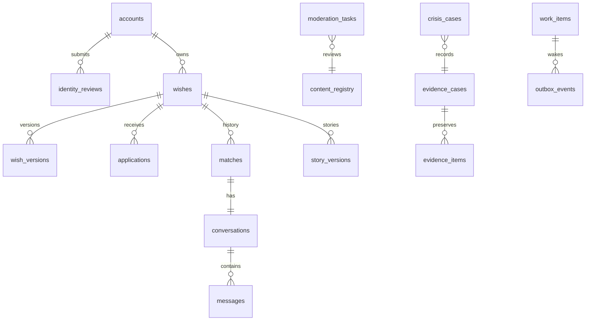

# 数据库设计

版本v0.2，2026-10-16。依据基线v0.2、G1及G2方案B。本文为逻辑与约束设计，待G3评审；不提供可执行DDL或迁移业务代码。以下表名/枚举/字段为设计决策，不伪称用户原始业务用词。

## 1. 存储规范（REQ-003、018、020）

PostgreSQL为唯一业务权威。主键使用随机UUID，时间使用timestamptz/UTC保存、北京时间展示；同一事务期限判断使用数据库时钟。可变聚合有version用于期望版本比较，内容版本与聚合状态版本分开。金额/积分首发无表。业务内容长度按Unicode码点，普通必填文本拒全空白。

敏感字段存ciphertext、key_ref、算法版本及必要nonce/tag；密钥不存本库。学号等值检索用独立密钥HMAC，非无盐哈希；学号/姓名/OpenID原文加密。公开展示为审核后的脱敏投影，不从ciphertext通用序列化输出。普通数据注销物理清理，deleting仅用于工作进行期，不以长期软删除代替删除。

## 2. 关系总览（REQ-002–008、014–019）

图只表达主要关系；证据不通过普通账号外键依赖存续，内容registry目标类型由应用及同事务校验，不能把多态ID视为自动具备外键完整性。

## 3. 身份与后台表（REQ-002、014、016、018、019）

| 表 | 核心字段 | 约束/索引/删除 |
| --- | --- | --- |
| accounts | id、lifecycle(active/deleting)、verification(unverified/pending/verified/rejected)、auth_epoch、nickname、hide_identity_tags、created_at | 此行兼账号guard，所有命令按ID排序锁定；deleting拒普通读写；清理完成物理删除，不永久保留purged用户行 |
| identity_secrets | account_id、student_number_cipher、student_number_hmac、name_cipher、wechat_openid_cipher、openid_hmac、key_ref | account_id唯一，学生学号有效占用独立唯一索引，OpenID身份绑定唯一；注销释放学号/OpenID普通占用，不删除合法案件证据 |
| identity_reviews | id、account_id、version、asset_id、status、reason、reviewer_id、reviewed_at | 每账号最多一当前待审版本；驳回原因必有；访问原卡经过审核场景；注销普通审核/卡清理 |
| sessions | id、subject_kind、subject_id、token_hash、auth_epoch、expires_at、revoked_at | 令牌只存摘要；每请求从DB检查生命周期/代次，Redis不作授权权威；注销与解罚角色变更可撤销 |
| admin_accounts / admin_role_bindings | id、credential_ref/password_hash、status；admin_id、role | 后台与学生账号独立命名空间；审核/危机/超管明确区分；变更角色提升权限仅超管 |
| blocks | owner_id、target_id、created_at | 有向唯一(owner,target)，业务任一方向存在即双向交互限制；注销清除相关行 |
| penalties | id、account_id、level、action_kind(warning/mute/ban)、violation_ref、starts_at、ends_at、reason_ref、first_displayed_at、confirmable_at、acknowledged_at、version、revoked_at | warning没有禁言效果，first_displayed_at首次写入且confirmable_at相差30秒，acknowledged_at不得更早；同一违规动作幂等唯一；mute/ban有效性按时间和撤销计算；禁言7天、永久封禁无ends_at；案件关联保留仅经证据域复制 |
| appeals | id、account_id、penalty_id、body_cipher、status、handler_id、decision_reason | 提交及处理限角色；成功解除处罚理由必有；涉案处置动作转证据，非涉案普通行注销清理 |

认证唯一性先约束有效账号的学号占用；注册绑定学号不等于审核通过。并发认证同一学号由唯一约束拒绝第二有效绑定，不能只依赖先查询。学号HMAC密钥轮换期间维护受控双代检索并保持逻辑唯一，版本与迁移验收见security.md。

## 4. 心愿、申请和会话表（REQ-003–008、014–016）

| 表 | 核心字段 | 约束/索引 |
| --- | --- | --- |
| wishes | id、owner_id、state、current_content_version、version、category、campus、duration_days、expires_at、refresh_on_publish、published_at、restriction_epoch | state见下节，duration_days∈1..30；索引(owner_id,state)、公开(category,campus,published_at,id)、到期(state,expires_at) |
| wish_versions | wish_id、content_version、body_cipher、public_body、identity_tags、reward_method、moderation_status、wordlist_version、school_related、school_detection_version、school_detection_state | (wish_id,content_version)唯一；public_body仅脱敏并已允许公开时可读；修改生成新版本，旧审核不能写新版本 |
| applications | id、wish_id、wish_content_version、applicant_id、status、version、message_cipher、content_version、cancel_reason、created_at | 对(wish_id,applicant_id)在pending_scan/pending_review/active范围部分唯一；accepted不再是未匹配申请；待审只给申请人状态、不展示留言给许愿人 |
| matches | id、wish_id、requester_id、helper_id、status(current/ended)、started_at、ended_at | 对wish_id在current范围部分唯一；普通已实现/已还愿仍保留匹配历史；注销清理关联时不保留普通身份占位ID |
| conversations | id、match_id、write_epoch、next_delivery_seq（初始1）、created_at | match_id唯一；会话可写是当前业务判定，不只看一个缓存开关；解绑旧会话仅原参与者可读 |
| messages | id、conversation_id、sender_id、delivery_seq（待审NULL）、delivered_at、version、client_message_id、body_cipher、content_version、status、cancel_epoch、created_at | (conversation_id,delivery_seq)对非NULL唯一，(conversation_id,sender_id,client_message_id)唯一；按(conversation_id,delivery_seq)索引；pending不可给接收人，delivered才可读 |
| story_versions | wish_id、story_version、author_id、body_cipher、public_body、moderation_status、school_related、school_detection_version、school_detection_state、withdrawn_at、created_at | (wish_id,story_version)唯一；仅许愿人可管理；状态与心愿已还愿分离，公开需当前审核通过且未撤回/限制 |
| content_registry | id、kind、entity_id、content_version、author_id、status、school_related、school_detection_version、school_detection_state | 唯一(kind,entity_id,content_version)；审核引用绑定精确版本；涉校判定元数据以此版本记录为权威，内容投影同步更新；目标存在性由同事务维护，注销删普通registry |

公开索引只能帮助筛选，不能将到期时间或跨表账号状态写成永恒有效的静态索引谓词。读取仍带当前期限、作者存续、版本/审核/限制条件。PostgreSQL支持部分唯一索引用于条件下的唯一性；本设计只在明确枚举状态条件使用。[部分索引文档](https://www.postgresql.org/docs/current/indexes-partial.html)。（REQ-005、006、008）

## 5. 状态映射与约束（REQ-004–008、014–018）

| 对象 | 设计状态 | 语义 |
| --- | --- | --- |
| wish.state | draft、pending_review、rejected、ready、published、matching、realized、fulfilled、withdrawn、expired | ready为审核通过待本人额度条件满足后上架；withdrawn为主动/例外撤下；违规/处罚/危机限制为独立标记，不靠state枚举丢失原因 |
| application.status | pending_scan、pending_review、active、accepted、withdrawn、rejected、invalidated | 待审计入去重但不可同意；拉黑/处罚/撤回/到期/改版等让旧申请终结，解除不恢复 |
| message.status | pending_scan、pending_review、delivered、rejected、cancelled | 已实现/还愿/解绑/拉黑/处罚/注销触发取消旧待审；delivered不因恢复而重新生成 |
| moderation.status | pending、machine_passed、human_required、approved、rejected、obsolete、cancelled | 审核结论不代表对象已公开或消息已送达，须另行执行当前业务复核 |
| work.status | pending、leased、retry_wait、completed、cancelled、attention | attention为异常待办，不等于可以绕过取消重新执行 |

wishes公开/匹配状态与matches相互约束需应用事务维护，不能只靠外键：published无current匹配，matching必须一个current匹配且会话原双方，fulfilled不能主动解绑；注销可清除已还愿普通匹配而保留作者自有心愿。matching→realized释放额度；realized→matching须B01占额校验；例外退出→withdrawn不占额。所有路径统一事务协议见architecture.md第3节。

普通上架与已实现回退均锁许愿人guard后计数；不使用Redis计数、MAX+1或无锁先查后写。同一事务过期不再计活跃；即使调度滞后，过期上架不可新增应愿。

## 6. 审核、危机及持久工作（REQ-006、014–019）

| 表/域 | 核心字段 | 安全及一致性 |
| --- | --- | --- |
| wordlist_versions / wordlist_entries | id、type、version、status；entry、action、version_id | 草案/发布版本，普通运营维护；扫描结果记录版本；规则样例与类型清单后续运营确认 |
| moderation_tasks | id、content_id、content_version、subject_epoch、hold_epoch、status、decision、reason、revision_suggestion、reviewer_id | 版本+权限代次校验；过时任务obsolete/cancelled不写当前对象；只开放命中案件正文；驳回reason/revision_suggestion各非空，作者状态接口分别返回 |
| reports | id、reporter_id、target_kind/id、type_code、status、handler_id | 报告不使所有正文自动永久保留；关联已认定违规/危机后按证据域复制 |
| content_restrictions | id、content_id、kind(violation/crisis/penalty)、source_ref、active、version | 独立记录限制原因；解除某一原因不能一并解除其他限制，当前公开读取必须全部校验 |
| privacy_holds | id、target_kind/id、hold_epoch、required_content_version、status、created_at、released_at | 同注销生效事务写入，绑定幸存内容而非注销者普通身份；有效hold阻止全部公开投影；新脱敏版本审核与代次匹配后才可解除，不能通过删matches级联移除 |
| evidence_cases | id、kind(violation/crisis)、source_ref、status、created_at | 仅已认定违规或已建危机事件可建立合法证据范围；不是所有举报/待审都建永久案件 |
| crisis_cases | id、evidence_case_id、content_type、status、detected_at、resolution、handler_id | 危机域，主体与内容加密放证据域；误报解除不直接公开；已建危机事件按基线例外保留 |
| evidence_items / evidence_actions | id、case_id、subject_cipher、body_cipher、asset_ref、key_ref；case_id、actor、action、at | case_id引用evidence_cases；独立schema/最小DB角色；学号和涉事正文限定保留，不以普通账号外键阻碍注销；超管可删并写恢复删除标记 |
| work_items | id、kind、target_kind/id、version、operation_id、status、lease_until、attempts、next_at | operation_id唯一；不带明文正文；任务为源，取消不可从MQ重建 |
| outbox_events | event_id、work_id、aggregate_id、aggregate_version、event_type、created_at、lease_until、sent_at | 索引未确认与可重试时间；业务/工作同事务插入；只携最小技术标识 |
| consumer_receipts | consumer_kind、operation_id、completed_at | 唯一(consumer_kind,operation_id)，与业务结果同事务；必要重试窗口后清理，不成为永久个人操作轨迹 |
| notifications / delivery_attempts | id、recipient_id、type、target_ref、read_at；notification_id、channel、status、attempted_at | 不复制内容/学号，仅通用消息；注销删本人通知及第三方通知中的其普通可识别关联；过期目标授权拒绝 |
| command_receipts | actor_id、command_kind、key_hash、request_hash、result_ref、expires_at | 同身份同路由同幂等键唯一，复用键不同请求409；保存对象引用非正文快照；注销删除，重放仍查当前授权 |

## 7. 对象、审计与删除（REQ-002、007、008、017、018）

| 表/记录 | 字段与生命周期 |
| --- | --- |
| assets | id、owner_id、purpose(student_card/evidence)、encrypted_object_key、object_version、wrapped_key_ref、status；不直接保存公开URL；用户卡注销删除，证据卡仅本身涉案可转证据域 |
| access_audits | id、actor_id、subject_ref、purpose、at、outcome；无姓名/正文/令牌；认证资料访问有记录，非涉案关联注销清理，涉案必要处置动作进入evidence_actions |
| deletion_jobs | job_id、subject_ref、phase、remaining_counts、error_code；工作期间受限可追踪，无敏感正文，完成后删subject关联，回执仅随机job句柄短期可查 |
| recovery_delete_journal | 独立存储中的随机实体/对象ID、删除范围、序号、技术时间、确认状态；无学号/OpenID/姓名/正文/角色浏览记录；用于恢复重删而非普通审计 |

恢复删除日志只覆盖仍可能存在于可恢复副本中的对象标识；身份映射已删后技术ID仍可能链接旧备份，故受限存储、不得对运营开放或称为匿名公共数据。所有相关备份与消息保留窗口均被核实已覆盖后，清除此标记；最长备份90天，窗口清理不能早于对象备份、消息重放和恢复清理确认。具体消息保留上限须部署时与此窗口对齐，不允许无限重放。

恢复日志与被恢复备份隔离，先持久删除意图/工作清单，再改变删除状态；任一步崩溃只能停在不可公开/不可访问状态，恢复必须先应用意图并完成核验。其设计仅保存实现REQ-018所需技术信息，不保留非涉案审计或普通账号身份；G3需核验最小化及清理可实施性。

注销删除顺序：阻断会话/交互和公开→按基线矩阵终结/撤下关系→取消待处理工作→普通数据库/对象清理及他人自有内容脱敏复审→清理通知/缓存/非涉案审计→完整性检查→移除普通账号guard/唯一占用→完成删除回执。清理期间普通字段不可访问，回执不宣称提前完成。

## 8. 迁移及验证（REQ-020、021）

实施后使用版本化迁移，不启动AutoMigrate，不混用模板MySQL迁移。先建约束/索引再开启命令入口；任何有历史数据的非空/唯一约束需核验数据后生效，失败不静默删业务数据。备份恢复不复用旧权限或旧消费者收件状态直接开放服务。

设计验证矩阵：部分唯一防并发重复申请/多当前匹配；按账号guard防3条超额与B01；审核版本+状态复核防迟到复活；六行注销矩阵保持存活方状态/额度；同人解除拉黑后旧申请不恢复；备份重删及超管证据删除闭环。实际DDL、查询计划、锁等待、索引体积和P95尚未执行验证，不宣称通过。

## 9. 评审修订的约束与验收（AR-001–AR-004）

关联REQ-007、008、015、016、018、019；来源为用户对本轮建议和推荐数值的明确采纳，见architecture.md第10节及评审处理记录。

- delivery_seq仅在最终送达事务分配，status=delivered必有delivery_seq与delivered_at；非送达状态不得占序号。next_delivery_seq与赋值同事务，回滚不消费，重试同消息保持原号；不得使用独立不可回滚数据库sequence预领聊天序号。A慢审/B先达反例应得到B=1、A=2。
- 轻微警告复用penalties，warning的ends_at为空但不得解释为永久封禁；是否限制交互由action_kind和当前时间判定，不能只看“有一行处罚”。警告关联violation_ref和content版本使移除动作可追踪；唯一业务动作及command_receipts防止重试重复警告。
- privacy_holds写在注销阶段2同事务中，相关作者行/心愿按统一锁序锁定；清理和删除普通匹配不会移除屏障。所有公开投影必须反连接有效hold，原审核结果即使approved也不能读public_body；新审核需比对content_version/hold_epoch。非涉案屏障记录不含注销人身份，完成后随内容生命周期清理，不变成永久非涉案审计。
- school_related为版本属性，判定未完成时使用school_detection_state=pending而不是默认false；通过的公开投影输出固定提示码与文本。审核驳回reason和revision_suggestion均必填，复核仍要检查版本和当前业务许可。

文档验收：送达事务回滚与重复不产生新序号；29秒确认拒绝/30秒成功；暂停注销清理仍不能公开旧故事；旧审核不能解除hold；新版本重判涉校且各入口提示一致。没有执行DDL或产品测试。
