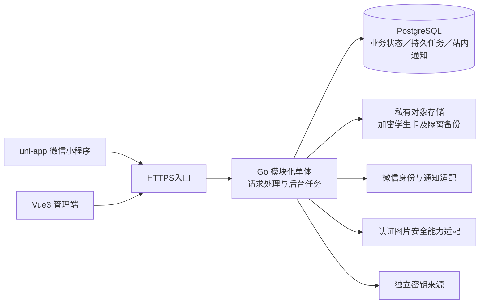
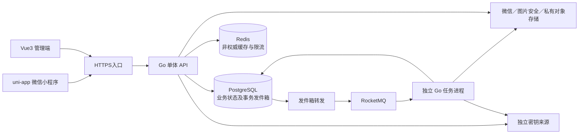

# 架构方案比较与G2选择材料

版本：v0.2，日期：2026-10-16。状态：**用户已选择方案B，待明确批准G2**。本文件不是定稿架构，不创建G2批准记录，不实现业务代码。

## 1. 输入、事实与边界

【已确认事实】G1批准记录为 `../approvals/G1.md`；批准的需求基线为 `../requirements/baseline.md` v0.2，对应提交 `9d1ad8ff8c9a71b477d2b180280b5cdb83f7b895`，SHA-256为 `fed56e2811cd21c5c5d461a35d9ace525b6f9bc142a01a6a1f2048303da54810`，本次读取核对一致。独立复审RR-001–RR-005全部关闭，G1结构检查通过。

【已确认事实】首发为微信小程序文字心愿闭环及Web管理端；学生卡是图片例外，普通业务图片、OCR、悄悄鲤、独立搭子、鲤币及公众号集成延期（REQ-001、002、009–013、019）。前端技术方案不得将延期模块带入首发。

【已确认事实】规模输入8000注册、2000日活、300峰值同时在线；普通列表服务端P95≤100ms，负载方案后续人工确认；可用性、RPO/RTO暂不设承诺。账号与外部资料按开发/上线阶段提供，当前未完成真实能力验证（REQ-021、017、020）。

【建议】两案均使用Go模块化单体、PostgreSQL、Vue3管理端、uni-app小程序、七牛云私有对象存储候选；区别是是否在首发引入Redis/RocketMQ和独立后台任务进程。依REQ-020，原文中间件是比较输入，最终选择须人工确认。

【假设，待技术验证】首发没有已确认的跨系统订阅需求，采用单库事务能表达首发业务边界；短轮询聊天在确认的请求频率下可能满足体验与资源要求，但300在线本身不能证明容量足够。该假设只支持方案推荐，不覆盖任何已批准业务规则。

## 2. 模板核验事实（REQ-020）

仅只读检查本地README、AGENTS、依赖清单和锁文件，未安装依赖、启动模板、改动模板或测试构建。快照标识只用于定位，并不保证模板工作区与提交完全一致；实际实现前应锁定并核验准确版本。

| 模板 | 本次读到的事实 | 适配缺口及限制 |
| --- | --- | --- |
| `~/code/go-template`，HEAD `f7c932f` | README为Go/Gin/GORM、显式依赖注入、健康检查、优雅退出；Go清单为1.25.0，含Gin 1.11.0、GORM 1.31.1、PostgreSQL驱动1.6.0、Redis客户端9.17.0、RocketMQ Go v2客户端2.1.2；有go.sum。依赖可按配置启用 | 示例API没有认证；生产权限、事务规则、内容审核、七牛接入、删除闭环须后续设计。现有RocketMQ是Producer，消费者、幂等、重试和死信须补齐，不能视为已有完整消息系统 |
| `~/code/vue3-template`，HEAD `897ba2d` | Vue3/TypeScript/Vite，Pinia及Router；有pnpm-lock.yaml和质量检查命令 | 不是现成审核后台；角色可见性、案件授权读取、私密学生卡展示及申诉后台须设计；不以客户端隐藏按钮替代服务端授权 |
| `~/code/uniapp-template`，HEAD `0efbda3` | uni-app Vue3微信小程序模板，编译包统一版本，有package-lock.json；含请求层与演示登录 | 默认Mock，文档中的手机号密码登录不是已批准的微信账号系统；微信身份交换、用户认证状态、聊天/审核状态、合法域名及分享需适配；客户端不能放AppSecret |

【建议】Go和两端模板分别保留各自构建及锁文件，不因都用Vue而强制共用一套运行依赖；可以共享文档契约，不在本阶段设计复杂跨端组件库。依赖版本为本地观测，不表示已核验最新、安全或互相兼容（REQ-001、019、020）。

## 3. 两案共用的业务模块边界

下列是建议模块职责，不是微服务、数据库表或API定稿；两案在业务语义上完全相同。

| 模块职责 | 需求追踪 | 不得丢失的规则 |
| --- | --- | --- |
| 身份、认证与后台授权 | REQ-002、018、019 | 有效学号唯一，认证资料仅审核场景完整可见；危机人员身份权限与普通运营区分；超级管理员权限有审计 |
| 心愿、申请及匹配 | REQ-003–006 | 版本化审核、唯一应愿人、3条额度与B01、期限判断；例外退出已撤下，不自动公开 |
| 会话与站内消息 | REQ-006、007、014、016 | 匹配/状态/处罚/拉黑决定可写；原会话不随新匹配泄漏；微信失败站内兜底 |
| 内容审核、举报、处罚与申诉 | REQ-014–016、019 | 待审不可直接送达或同意；内容通过后复核当前业务条件；旧交互取消后不重放 |
| 危机处置及证据 | REQ-017、018 | 先隔离再关怀/通知，夜间自动措施仍运行；误报解除重走普通审核；证据独立授权 |
| 广场、本人记录、还愿及分享 | REQ-008、014 | 公开列表与本人/匹配视图分开；分享每次重验；提交故事即已还愿，故事单独审 |
| 注销、对象清理及恢复处理 | REQ-004、005、007、008、018 | 基线10.4六行矩阵；注销不复活、普通数据删除、例外证据限定、备份90天及恢复重删 |

## 4. 方案A：模块化单体＋PostgreSQL持久任务（推荐）

关联REQ-001、004–008、014–021。首发不启用Redis/RocketMQ，复用数据库记录待处理工作与通知；七牛云仅承担必要私有对象和备份存储的候选角色，密钥管理单独设计。

【建议】初始为一个Go应用部署单元，内部HTTP处理与受控后台任务并行；同一镜像可在后续需要时拆为API/任务两种运行角色，业务模块仍不拆服务。应用退出等待正在处理的工作或使租约过期可重取；定时工作不依赖某个进程内存唯一保存（REQ-006、015、017、018、020）。

**持久工作处理建议：**业务状态变化与需要发送的通知/清理工作同事务落库；任务只携带最小对象标识和版本，避免把身份/聊天正文复制到任务载荷。工作者短事务领取、记录租约和重试状态，外部调用不持有长事务；完成落库时再次核验资格与版本，失败可重试，取消任务不能恢复。进程重启从未终结任务恢复，重复执行不重复产生匹配、重复公开或复活已删数据（REQ-004–007、015–018）。

PostgreSQL提供行级锁；其文档指出`SKIP LOCKED`适合多个消费者访问队列式表的场景，但不适用于要求一般一致视图的普通查询。本案将其作为任务领取候选，具体锁序、租约及故障恢复留到G2后的详细设计；不以它替代业务权限判断。[行锁说明](https://www.postgresql.org/docs/current/explicit-locking.html)、[SELECT与SKIP LOCKED](https://www.postgresql.org/docs/current/sql-select.html)。（REQ-005、006、015、018、020）

**聊天建议：**先用HTTPS发送、增量拉取已送达消息，客户端在页面可见时按后续确认的频率拉取，离开页面暂停/降频，服务端按会话授权及游标查询；站内通知保留独立未读列表。增量拉取不能读取待审消息或失效身份，微信通知与站内读取不是相互替代的同一机制。轮询频率、分页大小和未读刷新预算是负载验证参数，不在G2中偷偷变成体验SLA（REQ-006、007、008、021）。

**收益：**首发少维护Redis与Broker；核心状态、取消和待办在单库中更易统一复核；适合先完成有限校园互助闭环。**代价：**任务争用数据库资源，重试/租约/人工异常工作台须自行设计；聊天轮询增加读请求；一个部署单元内图片安全调用、后台任务可能影响HTTP资源，须连接池/任务并发隔离与压测，不能仅靠少组件断言性能达标（REQ-015、017、020、021）。

## 5. 方案B：模块化单体＋Redis＋RocketMQ＋独立任务进程

关联REQ-001、004–008、014–021。保持单一业务数据源，不因加入中间件改成微服务；API和任务进程分别部署，使用同一领域模块和规则。

【建议】业务写入与发件箱同事务提交，转发器再投Broker；消费方收到事件仍以PostgreSQL当前版本/资格为准，使用业务操作标识幂等。Redis只放可丢弃且可从权威源重建的数据，不决定额度、认证、处罚、拉黑、注销或公开权限。首发暂不缓存敏感正文或公开全文；若缓存列表候选ID，返回前仍从权威状态过滤，并不得用过期缓存绕过下线和注销（REQ-004–008、014–018）。

本案不能用“发送消息成功”代替业务事务成功，也不能依靠Broker顺序或重试自动得到业务恰好一次；重复消费要幂等，过时事件要丢弃/取消，失败重试和死信需观察及人工处理。RocketMQ官方也要求消费逻辑考虑幂等；模板只有Producer，选择B意味着消费者、监控及Broker配置的增量建设。[消费者最佳实践](https://rocketmq.apache.org/docs/best-practice-consumer/)、[消费重试](https://rocketmq.apache.org/docs/featureBehavior/10consumerretrypolicy/)。（REQ-006、007、015、017、018、020）

**聊天建议：**仍可使用与A相同的HTTPS增量拉取，公平比较一致性与运维成本；Redis/RocketMQ本身不提供符合本需求的站内聊天服务。若另选WebSocket，应单列小程序连接、重连、鉴权、断线补拉、撤销可见性的验证，不作为B默认已具备能力（REQ-007、020、021）。

**收益：**任务可独立扩容、资源隔离，具备更清晰的消费积压观察入口；Redis可承担后续证明确有必要的限流/热点优化。**代价：**多套状态与故障点、发件箱转发、消费幂等和删除屏障都仍需实现；多中间件意味着更多升级、凭据、备份边界和排障，不会消除单库一致性设计（REQ-015、017、018、020、021）。

## 6. 复杂度、成本、安全、维护与扩展比较

成本为相对构成，非报价；无已确认云区域、实例规格、资源预算、消息量或学生卡/备份体量，不编造月费用。

| 比较维度 | A：数据库持久任务 | B：Redis/RocketMQ任务进程 | 需求依据 |
| --- | --- | --- | --- |
| 组件与部署 | Go、PostgreSQL、两端静态产物、私有对象存储及密钥来源；任务起初同进程 | A基础上增加Redis、Broker/相关服务、转发与独立消费进程；静态产物相同 | REQ-001、019、020 |
| 开发复杂度 | 自行实现领取租约、重试、幂等，但与业务同库 | 自行实现发件箱、转发去重、消费/死信，外加缓存失效；模板不能免除这些工作 | REQ-006、015、017、018、020 |
| 直接资源成本 | DB承担业务和任务读写；主要为应用/DB/对象与备份/流量/密钥服务 | 增加Redis/Broker/消费进程资源及其监控；托管可减少值守但有服务费用 | REQ-018、020、021 |
| 人力维护成本 | 组件少，故障路径短；DB瓶颈和任务表膨胀须治理 | 多版本升级、Broker连接与积压、缓存一致性、权限和恢复流程更复杂 | REQ-020、021 |
| 安全 | 单库授权与删除边界较集中；数据库权限/日志泄漏仍须防范 | Broker、缓存和死信增加普通数据副本风险；事件不带敏感正文、删除时复核的要求更突出 | REQ-007、014、017、018 |
| 一致性 | 事务内状态与工作记录可一起提交，仍需跨对象锁序和业务复核 | DB仍为权威，Broker/Redis不能替代事务及业务判定；必须处理重复/迟到事件 | REQ-004–007、015、016、018 |
| 性能 | 简单查询及增量索引读取可验证100ms目标；后台工作竞争连接/CPU | 可独立分配消费资源、增加缓存候选，但多网络跳转及失效复核有成本 | REQ-021 |
| 故障恢复 | 数据库不可用时停止敏感读取/业务变更；任务随持久记录恢复 | 数据库不可用同样停止关键操作；MQ故障发件箱积压，Redis故障不得放松权限；更复杂补偿 | REQ-015、017、018 |
| 扩展 | 可先拆同一镜像的任务角色，再在证据支持下迁移投递通道 | 已具备独立消费者资源入口，适合实际积压大/多消费者需求；仍非无限扩容 | REQ-020、021 |
| 推荐度 | **首发推荐**：减少运维变量，先证明业务一致性与实际容量 | 备选：已有可靠托管运维条件，或验证证明任务隔离/队列生态收益超过成本时选 | REQ-001、020、021 |

不推荐首发微服务、多数据库或额外搜索集群：当前业务不要求跨团队独立发布或专门检索能力，增加分布式匹配/额度/删除一致性负担。此为架构判断，不修改未来扩展范围（REQ-001、004–008、018、020）。

## 7. 两案必须共同满足的技术原则

以下均为【建议实现方向】，用于比较能否承接已批准规则，详细表、接口和算法待G2后定稿。

### 7.1 事务、版本与时效（REQ-003–007、014–018）

- 对所有占用/释放活跃额度的路径统一检查；不能仅在新发布时检查，漏掉已实现回退B01。按许愿人维度串行化额度竞争，按心愿维度保证只有一个当前应愿人；数据库约束、锁序及重试共同验证。
- 将心愿内容版本、审核判定、公开/匹配状态分开表达；旧内容审核不能批准新版本。最终同意、公开和消息送达时在授权边界再次复核，审核通过不是业务执行许可。
- 处罚/拉黑生效、注销和交互执行需明确同一对象的并发先后；取消记录不因解罚或旧任务重试恢复。期限用权威时间判断，定时到期任务延迟不能使过期心愿继续接单。
- RR-001例外退出与RR-005应愿人注销后的未还愿心愿均已撤下，不占额度；已还愿的主动解绑禁止与注销清理优先级不得混淆。不用消息最终一致替代这些同步可见规则。

### 7.2 审核、外部依赖与通知（REQ-002、006、007、015、017、019）

- 文本词库按已确认三类可维护；学生卡图片识别通过外部适配边界接入，但不等同OCR认证。需验证外部处理失败、超时和凭据缺失，暂不公开/送达，不绕过学生认证人工审核。
- 同步提交只让待审状态持久存在，异步判定和人工结果依对象版本复核；危机先隔离，关怀卡及后台待办持久记录，外部通知失败保留重试。本站待办不可仅存Broker或内存。
- 微信授权、模板/服务通知资格、账号主体能力与分享入口必须按实际账号验证；不承诺每次微信通知送达。通知载荷不包含聊天正文、学生卡或完整学号，站内读取再次授权。
- 服务端时钟/后台调度按北京时间8–22人工安排展示，系统自动措施夜间继续；不自行加首次人工响应或认证审核SLA。

### 7.3 身份、对象与证据保护（REQ-002、007、008、014、017–019）

- 身份字段、学生卡原图和危机正文在存储前按敏感等级加密，密钥来源与数据库/对象备份隔离；学号查重需考虑非明文检索标识及注销后的唯一性释放，具体方案和轮换待安全设计。普通会话正文同样建议加密，但不新增对客户端端到端加密承诺。
- 七牛私有空间需要授权下载，但仅有可分享的签名URL不足以满足每次角色检查；学生卡/危机资料优先由服务端鉴权代理读取并记录访问，避免向后台直接发放长期可复用原图链接；禁止公共CDN缓存敏感文件。私有访问能力仍须真实账号验证。[七牛私有资源下载](https://developer.qiniu.com/kodo/1656/download-private)。
- 普通运营、身份审核场景、危机案件及超管分别做服务端字段授权；普通私聊只开放命中案件消息；管理端日志不记录完整身份、凭据、签名URL或私聊正文。前端路由权限不替代接口授权。
- 公开列表/分享不可只信缓存快照。浏览器、对象和应用缓存策略必须支持下线、撤回及注销后不再由服务器交付普通正文；无法撤销用户已自行保存的内容，不扩展为已批准的外部副本控制承诺。

### 7.4 注销与恢复删除闭环（REQ-004、005、007、008、018）

- 账号注销生效前禁止新交互并取消相关待审任务；随后完成普通数据库、对象、应用缓存及通知载荷清理，执行基线10.4六行矩阵。若采用分批清理，身份立即不可用、普通数据全程不可访问；清理未完成不得显示“全部删除完成”。具体完成时序须G2后设计，不放松基线删除义务。
- 普通任务/消息队列只放最小对象标识及版本；注销后任务不再读取正文或生成关系。证据保留在单独授权域，不因为内容曾待审就全部永久保存；超管删除证据也须覆盖其存储副本。
- 90天备份恢复后必须重新应用备份形成以来的注销/超管证据删除决定，再开放任何对外读取。删除决定的恢复依据需隔离于待恢复备份、仅存无法直接识别个人的最小技术对象标记，不作为永久保留非涉案身份审计的借口；其最小字段、保留/清理边界及恢复演练是G2后安全设计重点。
- 普通数据备份和永久证据分开管理生命周期；本案不以七牛版本历史/备份中仍有旧对象解释为在线可读，也不以恢复目标暂未设定省略恢复后重删。

## 8. 关键技术验证点与阶段闸口

本轮不编写业务代码或验证用业务原型，不运行模板构建、不进行真实数据试验。下表为后续设计/验证建议，全部绑定REQ；验证失败必须回到方案取舍或依赖问题，不能直接改需求兜底。

| 验证项 | 方案侧重点 | 验证通过依据/失败影响 | 时点与需求追踪 |
| --- | --- | --- | --- |
| V01 模板及依赖适配 | A确认未启用Redis/MQ不阻塞运行；B确认Producer及待补Consumer协议/部署兼容；两端登录契约核对 | 用固定模板/锁文件验证构建和连接；示例Mock/无鉴权不能当成真实账号系统 | 实施前验证；REQ-001、002、019、020 |
| V02 核心并发 | 两案都校验匹配、额度、回退、拉黑/处罚/注销与同意并发 | 按005-A/B/C、004-E、006-D矩阵至多一当前人、活跃数≤3、拉黑生效后无新增匹配；失败阻塞核心实现验收 | G2后详细设计并在实施中验证；REQ-004–006、014、016 |
| V03 任务恢复 | A杀进程/租约过期/重复领取；B加重复投递、发件箱发送中断、死信 | 通知待办不丢、取消不重放、旧审核不复活；不宣称外部通知恰好一次 | G2后设计/故障验证；REQ-006、007、015、017、018 |
| V04 100ms与轮询负载 | A任务争用与增量拉取；B缓存冷启动/失效复核与消费隔离 | 用户先确认频率、数据量、缓存及环境方案，再测普通列表服务端P95≤100ms；失败先索引/查询/并发优化，再比较增加组件 | 性能验收前；REQ-007、021 |
| V05 图片、账号和微信能力 | 两案相同的外部适配 | 学生卡识别失败不绕过人工、私有加密对象未授权不可读、通知失败站内兜底、分享按状态重验；依赖未就绪不得联调验收 | 真实账号资料就绪后；REQ-002、006、008、015、018 |
| V06 权限及敏感访问 | 服务端角色/场景字段授权、对象代理、案件私聊范围 | 002-C、007-A、015-C、018-A、019-A通过；直接对象访问及日志不能绕过授权 | 安全验收前；REQ-002、007、015、017–019 |
| V07 注销、证据与恢复 | A检查任务/DB/对象；B额外检查缓存、Broker、死信 | 10.4六场景及018-B/C/F通过；恢复后仍不能看到已注销普通数据，合法证据限定保留、超管删除有效 | G3设计评审明确闭环，实施后演练；REQ-004、005、007、008、018 |

【当前验证事实】只验证G1批准及基线哈希、模板文件存在/文档能力声明、REQ追踪和方案结构；没有V01–V07运行结果。实际性能、成本、账号资格、锁序正确性与删除恢复均尚未实测。它们不被写成“已经通过”。

## 9. 初始推荐及备选演进条件（REQ-020、021）

【历史设计建议】初始推荐A；用户现已选择B，当前选择以第10节为准。初始推荐原因是首发范围有限，尚无请求频率、消息积压或多系统消费者证据表明必须首发引入Redis/RocketMQ。以PostgreSQL统一业务与持久工作，先减少运维变量，再验证后台资源争用及列表目标，符合最简单可实施方案原则。

A不是不需要后台工作或可靠重试；它把这些放在数据库持久工作机制中。若已有团队成熟的托管Redis/RocketMQ与运维经验，且愿意承担发件箱/消费删除闭环的实现成本，可选B。

A后续演进顺序建议：先根据V04优化查询/索引和任务资源配额；需要隔离时将同镜像任务角色独立运行；只有任务积压/独立扩容或多消费者需求经验证成立时，再评估引入Broker；只有明确读瓶颈且可满足即时可见性时再评估Redis缓存。变更记录取舍，若影响已批准业务语义则重新需求确认，不自动切换方案（REQ-004–008、018、020、021）。

## 10. 用户选择与G2状态

| 选择 | 明确含义 | 未包含的自动授权 |
| --- | --- | --- |
| A（推荐） | Go模块化单体＋PostgreSQL持久任务；首发Redis/RocketMQ不启用；Vue3/uni-app及七牛私有对象候选按上述约束适配 | 不表示性能已通过、不决定云价格/实例规格、不是G3或上线批准 |
| B | Go模块化单体API＋独立任务进程＋PostgreSQL发件箱＋Redis/RocketMQ；接受额外部署、消费者和删除一致性成本 | 不表示模板已有消费闭环、不自动加WebSocket或微服务、不改变业务范围 |
| 调整方案 | 用户明确保留/删减的组件或部署约束后，修订比较材料 | 未明确取舍前不推断已经批准G2 |

【已确认事实】用户在当前主会话明确回复“选择B”。已选择第5节方案B（REQ-020）：Go模块化单体API＋独立任务进程＋PostgreSQL事务发件箱＋Redis＋RocketMQ，Vue3管理端、uni-app小程序及私有对象存储适配边界保持本文约束。选择B不自动增加微服务、WebSocket或延期业务功能。

【取舍记录】采用B所需的发件箱转发、消费幂等/重试/死信、缓存权限复核及注销删除闭环均进入后续设计范围；额外运维成本与容量仍须验证，不因选择而宣称就绪。

【待确认】方案选择已完成，当前仅待用户明确批准G2。只有用户明确批准并有G2记录后，才生成 `architecture.md`、`database.md`、`api.md`、`security.md`、`decisions.md`；不在本轮提前生成定稿表结构、接口定义或业务代码。

【后续依赖】负载方案、模板运行核验、真实账号与外部能力、密钥及备份恢复方案按第8节完成，不因选择架构而宣称它们就绪。G2审批记录应指向本选项文件版本/提交或内容指纹，包含选定方案、主要取舍、批准人、日期和明确决定。
