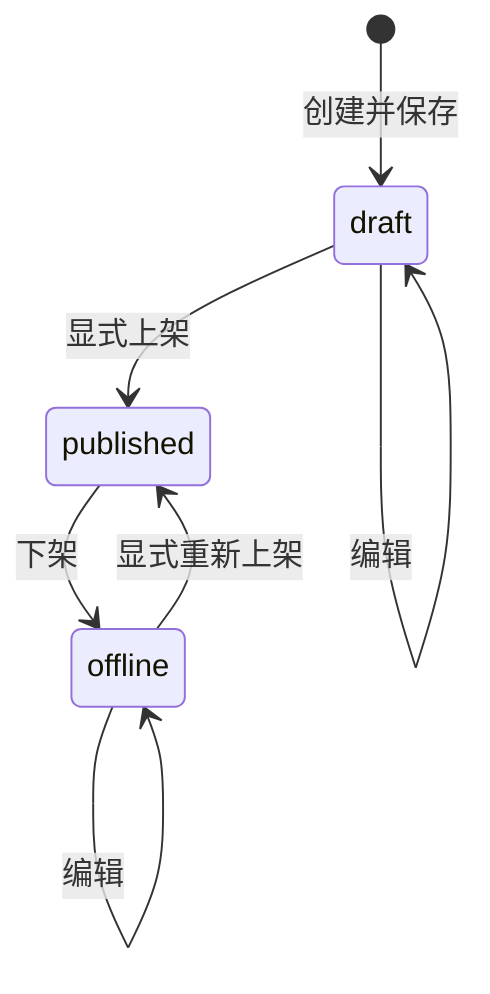

# 资料领域与后端设计

日期：2026-10-29。关联 REQ-023、REQ-002、REQ-014、REQ-016、REQ-018、REQ-019、REQ-020、REQ-021。依据[需求 v1.1](../../requirements/resource-plaza-v1.1.md)；版本基点与事实边界见[总览](README.md)。以下为设计，均未实现。

## 1. 模块归属及已核对的复用点

建议新增 `internal/resourceplaza`，管理资料、分类、查询和下载信息投影；HTTP边界放 `internal/httpapi`，实体放 `internal/entity`，依赖从显式应用装配注入。资料是后台维护的独立对象，不占心愿额度、不创建学生作者、不复用树洞匿名标识。

本次只读核对以下现有源码；路径均相对于相应源码仓库，未来动工须重新核对：

| 后端现有位置 | 已见事实与设计用途 |
| --- | --- |
| `internal/command/types.go`、`locks.go`、`engine.go` | 已有主体/账号/资源锁、版本期望及幂等回执；资源类型和锁序为显式枚举，新增类型必须完整接入，不能套用Wish锁 |
| `internal/safety/admin_users.go` | 当前后台查询先校验会话、后台guard及实时角色；可借鉴读事务，不直接沿用其允许三个角色的用户查询权限 |
| `internal/safety/admin_users_repository.go` | 已有ASCII折叠与字面子串搜索、分页前过滤；复用语义及测试方式，资料查询独立实现 |
| `internal/safety/commands.go` | 旧举报是独立安全流程；资料按用户新要求提供反馈，不改旧举报枚举或复用其案件/处罚动作 |
| `internal/studentapi/application.go`、`internal/httpapi/router.go`、`internal/devapp/application.go` | 应用显式装配领域；基础健康模式不注册真实业务。资料学生读服务与后台服务需分别注入 |
| `internal/entity/registry.go`、`internal/migration/` | 新实体需登记；专用SQL、权限与迁移检查不能由API启动隐式执行 |

## 2. 权限与读取一致性

学生读取谓词：有效学生会话且auth_epoch匹配、账号 `lifecycle=active`、`verification=verified`、当前无有效ban。mute不影响资料读取与复制；不能直接复用把mute也拒绝的通用Verified写入权限。后台资料管理谓词：有效后台会话、active后台账号，当前角色含 `review_operator` 或 `super_admin`。

所有入口都执行谓词，包括分类目录、列表、详情、取链、翻页、错误回显及命令重放。后台会话不能当学生会话读取，小程序会话不能访问后台。`allowed_actions` 只提示客户端，不能免除再次授权。

资料对学生可见还需满足 `status=published`、分类当前启用、无有效内容治理/隐私屏障。不存在与不可见对象均返回404；先判断主体权限，未认证主体不能借不同资料ID探测存在性。列表、游标、分类选项及摘要均不泄漏未上架内容。

读事务遵循现有主体guard和会话重验协议；先获取主体锁，再建立可见性查询使用的当前状态，避免先固定陈旧快照再等待锁。资料、分类和处罚条件由同一权威数据库读取。复制读取另外锁定资料及分类并核对 `expected_version`，与编辑/下架串行。

并发承诺以线性化点为准：下架/封禁/注销屏障提交后开始的新读取不得返回内容；与变更重叠且先完成授权读取的请求可能已发出响应，不能声称网络响应或剪贴板可被追溯撤回。页面在再进入、刷新、复制及会话变化时重验，不承诺无推送条件下即时擦除正在显示的旧画面。

## 3. 数据模型提案

| 对象 | 核心字段 | 约束与用途 |
| --- | --- | --- |
| `resource_categories` | UUID id、name、name_key、sort_order、enabled、version、created_at、updated_at | name_key为去首尾空白后ASCII折叠的名称，唯一约束；name保留展示大小写；无父节点、无硬删除 |
| `resource_items` | UUID id、category_id、title、description、download_url_cipher、extraction_code_cipher、status、version、content_version、created_at、updated_at、published_at、created_by、updated_by | 分类外键restrict；状态仅draft/published/offline；必填资料创建时即完整；无student author_id |
| `resource_holds` | UUID id、resource_id、kind、source_ref、active、reason_cipher、created_at、version | 资料的content/privacy屏障引用；由适用的有权治理/隐私流程管理，不由反馈生成，不向普通客户端返回原因原文 |
| `resource_actions` | UUID id、admin_id、resource_kind/id、action、from/to_version、created_at、reason_cipher可空、request_id | 记录有业务状态变化的后台动作；分类动作同样留迹，不复制全文和链接 |
| `resource_feedback` | UUID id、account_id、resource_id、content_version、kind、version、created_at、updated_at | `(account_id,resource_id,content_version)`唯一；kind仅valid/link_invalid/outdated/incomplete；无说明正文、附件或学生身份投影 |
| 通用命令回执 | 主体、方法、规范路径、键摘要、请求摘要、结果引用 | 复用既有引擎，不保留原请求或历史完整响应 |

标题与简介因搜索需求保留业务文本，只允许受限业务身份读取；不含学生个人资料。链接和提取码使用既有加密codec，附资源ID及用途区分的关联数据；列表查询不解密。缺密钥、解密失败拒绝详情/取链，不将密文或空串当正常链接。提取码无值时数据库及DTO均为null。

资源 `version` 初始1，内容保存、上架、下架及适用屏障变化各递增一次；`content_version` 初始1，仅实质内容变更（标题/分类/简介/链接/码）递增。完全相同内容保存是无变化成功，不增版本或重复留迹。分类的version单独递增；改分类名称不增加引用资料版本，展示时取当前名称。反馈有独立version，不递增资料version，避免一次反馈使所有读者的复制版本过期。

`created_at` 固定；`updated_at` 每次实质变更更新；`published_at` 记录最近一次显式上架，初始null，下架后保留。所有时间由服务器生成，以UTC传输，界面北京时间显示。业务排序使用固定的created_at，不使用可变published_at。

建议索引：资料 `(created_at DESC,id DESC)`、`(category_id,status,created_at DESC,id DESC)`，以及适合published可见范围的部分索引；分类 `(sort_order,id)` 和name_key唯一索引。任意中部包含搜索不因有普通B-tree索引就宣称达标；先测实际数据及高命中场景，再决定是否需要额外索引，不引入搜索副本。

## 4. 字段规范化与校验

需求规定上限见[字段表](../../requirements/resource-plaza-v1.1.md)。计数为Unicode码点，链接单独按UTF-8字节计数；不按UTF-16 code unit计算。前后端采用同一测试样例，后端始终权威。

统一去首尾空白集合：U+0009–000D、U+0020、U+0085、U+00A0、U+1680、U+2000–200A、U+2028、U+2029、U+202F、U+205F、U+3000；不隐式做Unicode规范化、全半角转换或转码。标题、分类名、提取码禁止剩余换行和控制字符。简介将CRLF/CR统一为LF后去首尾空白并计数，允许LF和TAB，拒绝其他控制字符；缺省、null或全空白简介统一为 `""`。提取码缺省、null或全空白统一为null。内部普通空格保留。

关键词去相同首尾空白；内部空白参与匹配，控制字符拒绝。只对ASCII A–Z作小写折叠，不对中文、全角或其他Unicode字符作大小写/相似变换。数据与关键词使用同一折叠，参数绑定后字面包含匹配；不拼接SQL、不把 `%`/`_` 当通配符。

URL只做绝对HTTP/HTTPS地址结构及长度检查，不要求特定网盘域名。禁止userinfo、空主机、剩余空白/控制字符；保留去首尾空白后的原串，不修改签名查询参数、大小写、百分号编码或片段，不自动抽取粘贴文本中的第一个链接。仅存储和展示，不发起HTTP请求、跟随重定向、生成站点预览或返回302；不因此声称已验证域名、内容安全、权限或链接存活。

## 5. 状态与命令

内容治理/隐私屏障是独立条件；状态为published也不能绕过屏障读取。解除屏障不自动上架。

屏障适配作为后端的内部受控能力：施加时锁资料、建立来源引用、置offline并增资料version；解除只移除获授权的对应屏障，仍保持offline。只允许适用的治理/隐私流程调用，不提供普通资料编辑表单可写的blocked字段；正式契约/实现评审须核对来源权限与清理路径。没有屏障时visible条件直接由上架、分类及账号资格决定，不为反馈额外创建安全案件。

| 命令 | 事务内检查 | 结果 |
| --- | --- | --- |
| 创建资料 | 当前后台角色、完整字段、新分类启用、创建幂等 | 新draft及审计；一次创建只分配一个ID |
| 保存资料 | 当前角色、resource.version、状态draft/offline、旧/新分类、完整替换字段 | 内容实质改变才增两个版本及写审计；不改为published |
| 上架 | 当前角色、resource.version、draft/offline、有效分类及字段、无治理/隐私屏障 | published，version+1，更新published_at；不抓取外部链接 |
| 下架 | 当前角色、resource.version、published、非空理由 | offline，version+1，保留原内容及published_at；成功即生效 |
| 分类更新 | 当前角色、category.version、名称唯一与字段合法；停用时检查所有引用 | 分类version+1并审计；有关联资料拒绝停用，无隐式级联 |

创建后的所有变更带准确目标版本；资料版本、分类版本、本人反馈版本互不替代。不同幂等键重复“上架已上架”“下架已下架”返回状态冲突，促使客户端重读；同键原命令重放按回执返回当前可授权结果，不再执行原动作。下架成功后保存失败不会恢复上架；已存在的草稿/下架资料没有硬删除入口。

## 6. 锁序、并发及幂等

沿用现有引擎的后台主体→学生账号→资源锁全局顺序；资料分类、资料及本人反馈须增加明确锁资源与稳定排序。新类型间按分类→资料→已存在的反馈，种类内按ID排序；保持所有旧类型相对顺序，统一在锁计划中取得，不在业务回调临时倒序加锁。首次反馈没有记录时，在账号guard和资料锁内检查唯一键并创建。

编辑发现旧/新分类及资料，分类停用锁分类再检查引用；所有创建、改类及上架也锁该分类，因此“查无引用再停用”和“同时新增引用”不能双双成功。发现计划后目标分类变化时按现有发现重验机制重试，不持不完整锁直接执行。资源与审计、幂等回执同事务提交，失败整体回滚。

后台命令都使用 `Idempotency-Key`；作用域包含主体、HTTP方法、规范资源路径及键，请求摘要包含规范化完整字段、理由和expected_version。相同键不同请求返回409。重放先检查当前角色、会话及对象访问，再解析结果引用；不能因存在旧回执绕过撤权、回放旧链接或将已下架资料重新上架。原请求超时但已成功时，同键同内容可恢复当前结果；业务冲突后不自动换新键重提。

建议后台资料/分类创建与变更的最小回执保留到目标对象生命周期结束，使用既有 `RetainReceipt` 能力，避免技术TTL到期后同键重复创建；资料/分类首期无硬删除。只存结果引用及摘要，不存原文/提取码。学生反馈回执保留至对应内容版本终结或该学生注销，清理旧反馈时同步清理其回执；旧content_version不能重建已清理反馈。

## 7. 四类反馈与固定二维码（REQ-023）

资料明确不设举报。反馈kind固定映射：`valid`＝有效、`link_invalid`＝链接失效、`outdated`＝年代久远、`incomplete`＝不全。只接受这四个值，不接描述、文件、联系方式或安全案件引用；反馈不调用举报、处罚或危机工作流，也不触发自动下架。

提交/改选反馈要求当前可读且无有效mute/ban；后台会话不能代学生提交。客户端携带 `expected_content_version`、`expected_feedback_version` 和kind，初次反馈版本期望为0；当前内容版本必须一致，未上架或已失权拒绝。锁内检查本人唯一键；首次创建version=1，改选递增反馈version；同选项无变化成功，不增版本。同键同请求重放只能返回当前授权、当前内容版本的本人结果，不恢复旧选择；同一反馈有新版本时，旧不同键请求返回409。

每个资料内容版本统计每账号的当前一票。后台查询按四类GROUP BY并过滤账号lifecycle=active，不维护易失步的独立计数器、不展示反馈用户ID或名单；学生仅看到本人选择，不展示全站反馈排名或他人反馈。后台列表按当前页批量聚合，避免N+1；详情同样显示四类计数和总数，均基于同一查询视图。

内容编辑并递增content_version时，同事务删除旧版普通反馈，当前统计归零；无变化保存、仅上下架或分类改名不清空反馈。旧反馈不作为历史证据保留。资源处于offline时后台仍可看当前版本统计，但学生不能新提交；反馈人数与浏览/下载次数没有等价关系。

资料投稿是小程序静态联系入口，不新增后端投稿、文件存储或二维码上传接口。拟放置一个运营提供的PNG/JPEG图片资源，由构建配置选择固定路径，登记资源版本及SHA-256；二维码不从任意网络URL或学生输入生成。它作为静态联络图片，不承诺认证外保密；资料本身仍严格鉴权。实际图片未提供前使用明确不可用状态，不造示例联系人代替正式图。

## 8. 数据访问、审计与注销

受限运行身份及RLS/权限函数必须覆盖新表与查询；不为方便后台学生共用连接而提升为数据库owner。既有旧接口默认不枚举新资料内容；迁移通过新版本显式授权，新表及字段具有中文对象注释，已有迁移不重写，迁移编号按实施时最新序列分配。

技术日志只记录动作、request_id、耗时、结果及必要安全标识；网关/APM/SQL日志屏蔽关键词、请求体、完整URL值、链接、码和简介。业务动作审计记录操作者和版本，理由加密；不记录下载计数或长期学生浏览轨迹，读取成功不新增学生行为表。

后台维护的共享资料不随某学生注销删除。学生反馈及其命令回执主体关联属于普通数据，纳入REQ-018注销清理图；注销屏障提交后即从统计中过滤，不等待物理删除，旧会话/命令不能重建反馈。内容若涉及注销对象仍先屏障再受控处理，不以“后台发布”绕过隐私删除。反馈不作为永久证据；备份90天和恢复后重执行删除继续适用。

## 9. 运行及性能

第一阶段不新增搜索服务、下载worker或网盘供应商SDK；资料读写及反馈在现有API内。反馈清理由现有隐私worker的显式扩展承担，尚未接入清理图时不得宣称注销验收通过。

新增配置/依赖失败不得注册半可用取链接口；健康模式仍只提供健康能力。测量普通列表、分类+关键词、仅简介命中、无结果与足量后续页，报告数据量、并发负载、样本数和分组P95。没有实测前不以资料行数少或索引存在宣称满足REQ-021。
